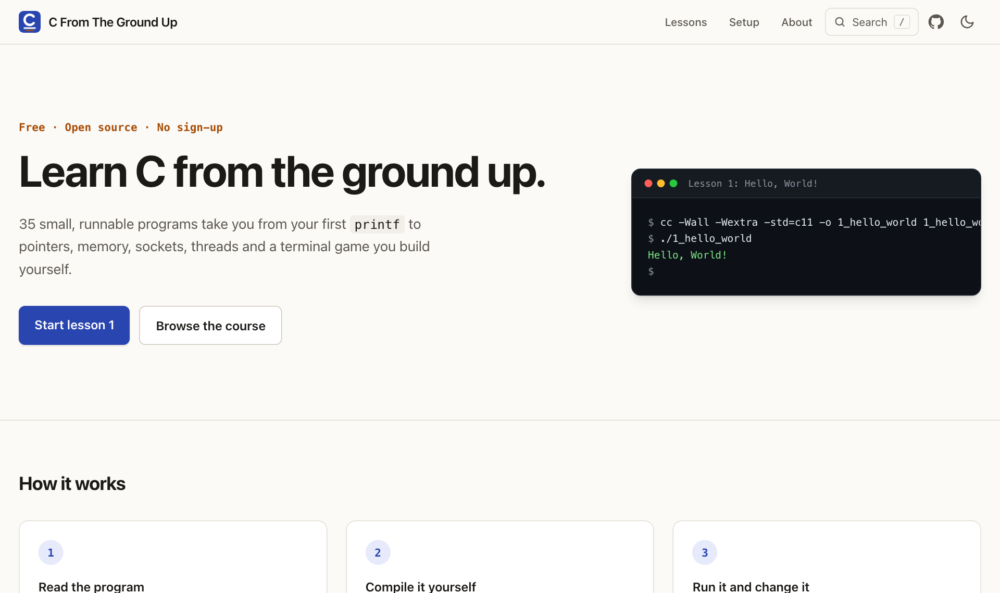
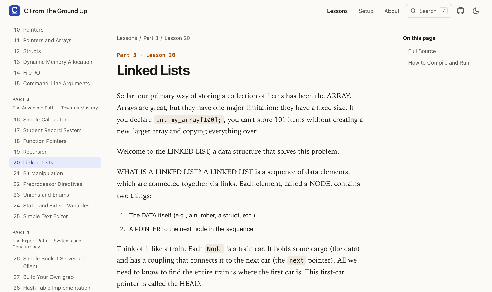
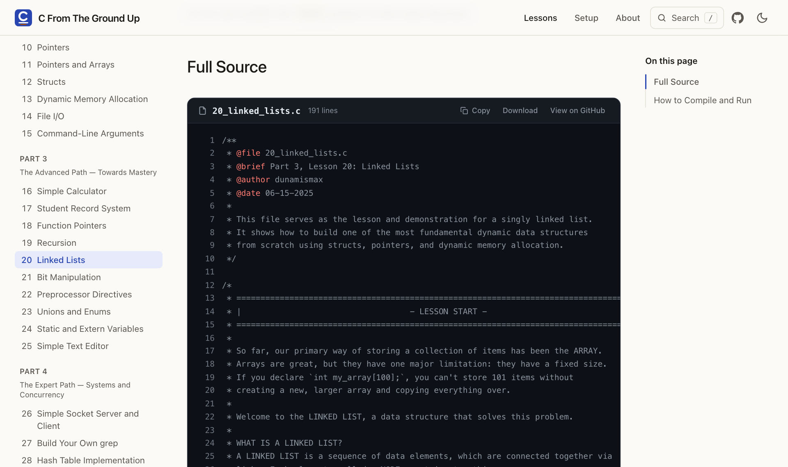

<div align="center">

<a href="https://cfromthegroundup.com"></a>

# C From The Ground Up

**A free, progressive course in C: 35 small, runnable programs that take you
from your first `printf` to pointers, memory, sockets, threads and a terminal
game you build yourself.**

## [Start learning at cfromthegroundup.com &rarr;](https://cfromthegroundup.com)

[Start lesson 1](https://cfromthegroundup.com/lessons/01-hello-world) &middot;
[Browse all 35 lessons](https://cfromthegroundup.com/lessons) &middot;
[Set up a compiler](https://cfromthegroundup.com/setup)

Free &middot; Open source &middot; No sign-up &middot; No ads or trackers

<br>

<a href="https://cfromthegroundup.com">
  <picture>
    <source media="(prefers-color-scheme: dark)" srcset="assets/images/site/home-dark.png">
    
  </picture>
</a>

</div>

## The course website

**[cfromthegroundup.com](https://cfromthegroundup.com) is the best way to take
this course.** It is built from the files in this repository, so it always
shows exactly the code that compiles here, and it adds everything you want
while learning:

- **Lessons made for reading.** Each lesson is a page: the explanation first,
  then the full program with line numbers and syntax highlighting, where the
  comments are the lesson.
- **Track your progress.** Mark lessons complete, see how far you are through
  each part, and pick up where you left off. Your progress is saved in your
  browser, with no account needed.
- **Run code without installing anything.** "Try it online" opens most
  lessons in Compiler Explorer with the right flags, ready to run.
- **Compile it yourself, on any system.** Every lesson has copy-ready compile
  and run commands for macOS, Linux and Windows (WSL), and the
  [setup guide](https://cfromthegroundup.com/setup) walks you through
  installing a compiler.
- **Find anything.** Search every lesson, heading and code comment. Press `/`
  anywhere on the site.
- **Take it with you.** Download any file, any lesson as a zip, or the
  [whole course](https://cfromthegroundup.com/downloads/c-from-the-ground-up.zip).
- **Built for everyone.** Light and dark themes, full keyboard navigation (`j`
  and `k` move between lessons), automated WCAG 2.2 AA accessibility checks,
  and fast pages: Lighthouse scores of 99 to 100.

<table>
  <tr>
    <td width="50%">
      <a href="https://cfromthegroundup.com/lessons/20-linked-lists">
        <picture>
          <source media="(prefers-color-scheme: dark)" srcset="assets/images/site/lesson-dark.png">
          
        </picture>
      </a>
      <p align="center"><sub>Every lesson explained in plain language</sub></p>
    </td>
    <td width="50%">
      <a href="https://cfromthegroundup.com/lessons/20-linked-lists#full-source">
        <picture>
          <source media="(prefers-color-scheme: dark)" srcset="assets/images/site/code-dark.png">
          
        </picture>
      </a>
      <p align="center"><sub>The full program, with the comments as the lesson</sub></p>
    </td>
  </tr>
</table>

## What you will learn

Five parts, taken in order. Each lesson only uses ideas that earlier lessons
taught.

| Part | Lessons | What it covers |
| --- | --- | --- |
| [**1. The Beginner Path**](https://cfromthegroundup.com/parts/1) | 1-9 | Hello World, variables, input, operators, conditions, loops, functions, arrays and strings |
| [**2. The Intermediate Path**](https://cfromthegroundup.com/parts/2) | 10-15 | Pointers, structs, dynamic memory, file I/O and command-line arguments |
| [**3. The Advanced Path**](https://cfromthegroundup.com/parts/3) | 16-25 | Function pointers, recursion, linked lists, bit manipulation, the preprocessor and a line-based text editor |
| [**4. The Expert Path**](https://cfromthegroundup.com/parts/4) | 26-30 | Sockets, your own `grep`, hash tables, a tiny shell and multithreading |
| [**5. Expert Systems**](https://cfromthegroundup.com/parts/5) | 31-35 | Multi-file projects, external libraries, ncurses terminal UIs, data parsing and a capstone text adventure |

**[Start with lesson 1: Hello, World! &rarr;](https://cfromthegroundup.com/lessons/01-hello-world)**

## Other ways to read it

- **The book edition:** the same lessons as an
  [mdBook on GitHub Pages](https://dunamismax.github.io/c-from-the-ground-up/).
  It is kept as a mirror, and every page links to its lesson on the site.
- **This repository:** the source of the course. Every lesson is one `.c` file
  under `Part */`, and the site and the book are both generated from those
  files. Clone it to read and run the lessons in your own editor.

## Running the lessons from this repository

Most lessons are single-file programs. Pick one `.c` file, compile it, and run it:

```sh
cc -Wall -Wextra -std=c23 \
  "Part 1 - The Beginner Path_ Core Concepts/1_hello_world.c" \
  -o /tmp/1_hello_world

/tmp/1_hello_world
```

If your compiler does not support `-std=c23` yet, use `-std=c17`. The site's
[setup guide](https://cfromthegroundup.com/setup) covers installing a compiler
on macOS, Linux and Windows.

Lesson 31 is the exception: it is intentionally split across multiple files and built with its local `Makefile`.

```sh
make -C "Part 5 - Expert Systems & Application Development/31_make_files_for_multi_file_projects"
```

### Build notes

- The repo-level verification baseline prefers `-std=c23` and falls back to `-std=c17` when a compiler does not yet accept C23.
- Most lessons compile with `cc -Wall -Wextra -Wpedantic -Wstrict-prototypes -std=c23 lesson.c -o lesson_name`.
- CI also turns on `-Wshadow -Wconversion -Wsign-conversion -Wmissing-prototypes` and treats every warning as an error, under both GCC and Clang.
- Lessons 26 through 30 use POSIX or Unix-style APIs such as sockets, `fork`, `waitpid`, `unistd.h`, and `pthread`.
- Lesson 30 needs `-pthread`.
- Lesson 32 needs `-lm`.
- Lessons 33 and 35 need `-lncurses` or `-lncursesw`, depending on your system, so they are easiest to run on Unix-like systems or inside WSL on Windows.
- Several lessons expect runtime input or data files. Read the lesson comments before running them.

## Working on the project

The website lives in [`site/`](site/) (SvelteKit, Svelte 5, TypeScript,
Tailwind CSS, PostgreSQL) and reads the lessons and chapters at build time;
[`site/README.md`](site/README.md) has the developer quick start. The book is
built with mdBook:

```sh
mdbook build
mdbook serve --open
```

One command runs the full local gate, the same checks CI runs:

```sh
make verify
```

It checks that the book's listings match the `.c` files and that the lessons
are formatted, runs clang-tidy over them, builds the book and checks its links,
compiles every lesson with warnings as errors under Clang and GCC (and runs
behavioural checks on the interactive ones), runs the lessons under
AddressSanitizer, UndefinedBehaviorSanitizer and LeakSanitizer, and
type-checks, lints, tests and builds the website. If your local GCC is
versioned, point at it with `make verify GCC=gcc-15`; on macOS, plain `gcc` is
usually Clang under another name. The website's end-to-end tests run with
`make site-e2e`.

You need a C compiler, `make`, Python 3, mdBook 0.5.4, clang-format and
clang-tidy 23, the ncurses headers, and Node 24 with npm.
[AGENTS.md](AGENTS.md#verification) lists the exact versions and how to install
them.

The `.c` files are the single source of truth for code. Each chapter in
`src/chapters/` embeds its lesson's source through a `<!-- source: ... -->`
marker, and `make sync` copies the current file contents into the book. Edit
the `.c` file, run `make sync`, then `make verify`.

- [AGENTS.md](AGENTS.md) -- repository layout, conventions, and the workflow
  for changing or adding lessons and working on the site (written for AI
  agents, useful for humans too)
- [BUILD.md](BUILD.md) -- what is being worked on now, the roadmap, open
  decisions, and the improvement backlog

Found a mistake, or a comment that confused you? A wrong comment is a bug:
please [open an issue](https://github.com/dunamismax/c-from-the-ground-up/issues).

## License

This project is licensed under the MIT License. See [LICENSE](LICENSE).
